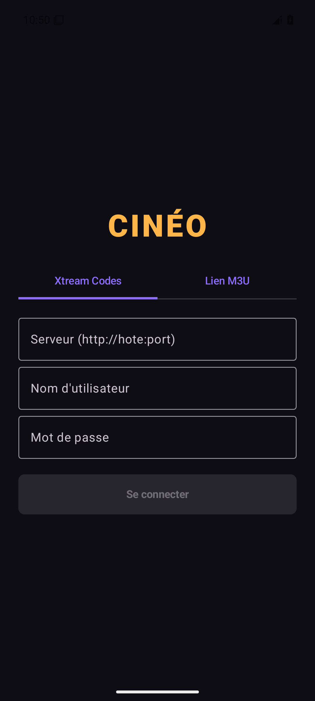
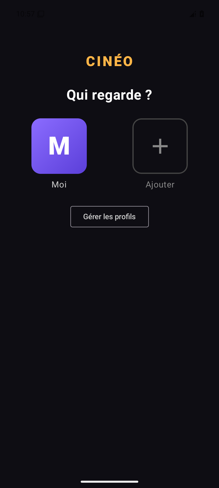
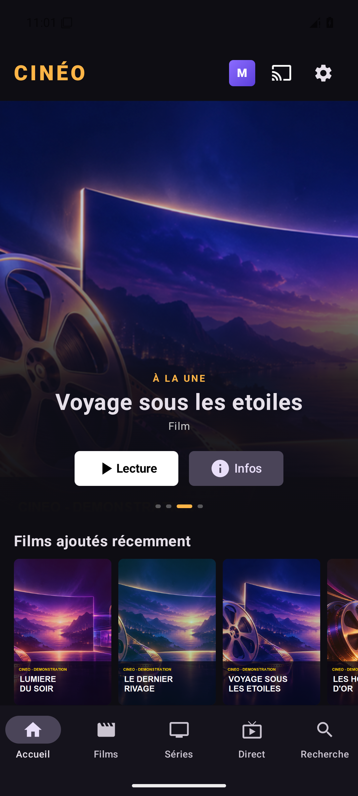
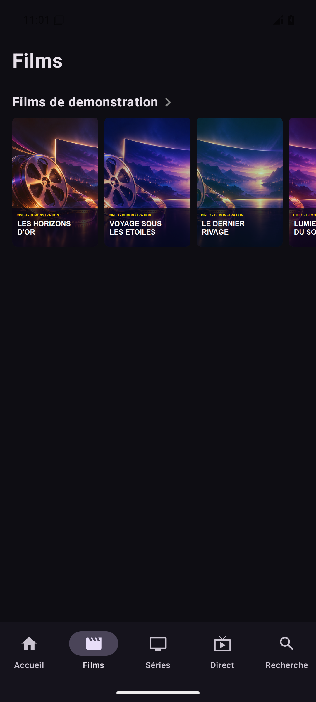

<div align="center">


# Cinéo

**Vos films, vos séries et votre télévision en direct, réunis dans une application Android.**

[Installer l'application](#installation) · [Fonctionnalités](#fonctionnalités) · [Premiers pas](#premiers-pas) · [Compiler](#compiler-le-projet)

</div>

---

Cinéo est un lecteur pour vos services compatibles **Xtream Codes** et vos playlists **M3U**. Son interface sombre, pensée pour les écrans tactiles et la navigation à la télécommande, vous permet de retrouver votre catalogue sur Android et Android TV.

> Cinéo ne fournit ni abonnement, ni chaîne, ni catalogue. Utilisez vos propres sources et assurez-vous d'avoir les droits nécessaires pour accéder à leurs contenus.

## Fonctionnalités

| | |
|---|---|
| 🎬 **Films et séries** | Parcours par catégories, fiches de détail, recherche et enchaînement des épisodes. |
| 📺 **Télévision en direct** | Chaînes, guide des programmes et replay lorsque le fournisseur les propose. |
| 👤 **Profils** | Une liste de favoris et un historique de visionnage propres à chaque profil. |
| ✨ **À retrouver** | Reprise de lecture et recommandations basées sur l'historique et les favoris. |
| 🔒 **Contrôle parental** | Masquage du contenu adulte et accès protégé par code PIN. |
| 📡 **Chromecast** | Diffusion vers un appareil Cast compatible. |
| ▶️ **Lecteur intégré** | Lecture avec Media3/ExoPlayer, pistes audio, sous-titres et choix du format d'image ; relais vers VLC en cas de format non pris en charge. |
| 🔄 **Comptes et mises à jour** | Comptes enregistrés, avertissement en cas de limite de connexions atteinte et recherche de nouvelles versions sur GitHub. |

Certaines fonctions, notamment le guide TV, le replay et les informations détaillées, dépendent du fournisseur et de la source utilisée. Avec une playlist M3U classique, les entrées sont classées en direct ou en films et le guide Xtream n'est pas disponible.

## Aperçu

Captures réalisées dans l'émulateur Android avec un catalogue et des jaquettes fictifs.

<div align="center">
  
  
  
  
</div>

## Installation

1. Sur votre appareil Android ou Android TV, téléchargez l'APK depuis les [releases GitHub](https://github.com/jessux/cineo/releases/latest).
2. Ouvrez le fichier téléchargé et autorisez, si nécessaire, l'installation depuis cette source dans les paramètres Android.
3. Lancez **Cinéo** et renseignez votre accès.

Android **7.0 (API 24)** ou supérieur est nécessaire. Le dépôt contient également un [APK dans le dossier release](release/Cineo.apk) et une archive d'extension Kodi.

## Premiers pas

1. Choisissez **Xtream Codes** et saisissez l'adresse du serveur, votre identifiant et votre mot de passe ; ou choisissez **Lien M3U** et collez l'URL de votre playlist.
2. Sélectionnez ou créez un profil.
3. Explorez les onglets **Accueil**, **Films**, **Séries**, **Direct** et **Recherche**.
4. Ajoutez vos contenus à votre liste, reprenez vos lectures ou diffusez-les sur un appareil Cast.

Les identifiants sont enregistrés localement par l'application. Évitez de partager des captures d'écran contenant des informations de compte ou des URL privées. Le projet autorise aussi les connexions HTTP non chiffrées : privilégiez HTTPS lorsque votre fournisseur le permet.

## Compiler le projet

### Prérequis

- JDK **17 ou supérieur**.
- SDK Android avec la plateforme **Android 35** et les outils de build correspondants.
- Connexion Internet pour télécharger les dépendances Gradle au premier lancement.

Configurez le chemin du SDK Android avec `ANDROID_HOME` ou dans le fichier local `local.properties`, par exemple sous Windows :

```properties
sdk.dir=C:\\Users\\VotreNom\\AppData\\Local\\Android\\Sdk
```

Le wrapper Gradle fourni se charge de télécharger la version de Gradle du projet.

### APK de développement

Sous Windows :

```powershell
.\gradlew.bat assembleDebug
```

Sous macOS ou Linux :

```sh
./gradlew assembleDebug
```

L'APK est généré dans `app/build/outputs/apk/debug/`. Pour l'installer sur un appareil connecté avec le débogage USB activé :

```sh
adb install -r app/build/outputs/apk/debug/app-debug.apk
```

### APK release

```sh
./gradlew assembleRelease
```

Sous Windows, utilisez `.\gradlew.bat assembleRelease`. Le fichier est généré dans `app/build/outputs/apk/release/`.

Pour signer une release avec votre propre clé, définissez `KEYSTORE_FILE` (chemin du keystore) et `KEYSTORE_PASS` ; l'alias attendu est `cineo`, avec le même mot de passe pour la clé et le keystore. Sans `KEYSTORE_FILE`, le build release utilise la clé de debug : il ne pourra pas mettre à jour une application signée avec une autre clé. Ne versionnez jamais votre keystore ou vos mots de passe.

## Technologies

**Kotlin** · **Jetpack Compose** · **Android Media3 / ExoPlayer** · **FFmpeg** · **Google Cast** · **Gradle**

---

<div align="center">
Fait pour retrouver le plaisir de choisir quoi regarder.
</div>
